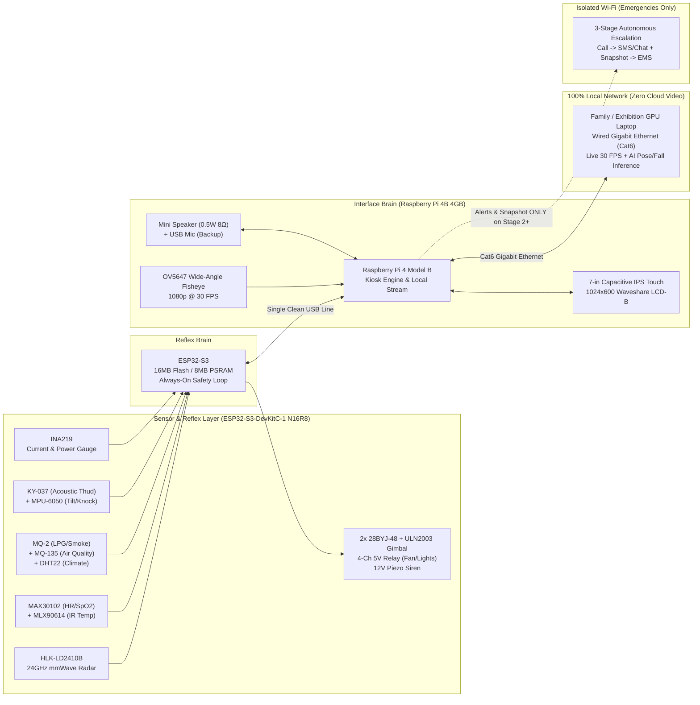
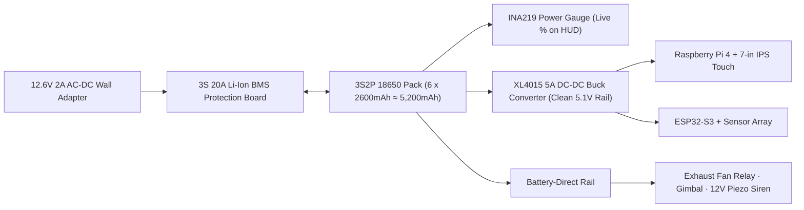
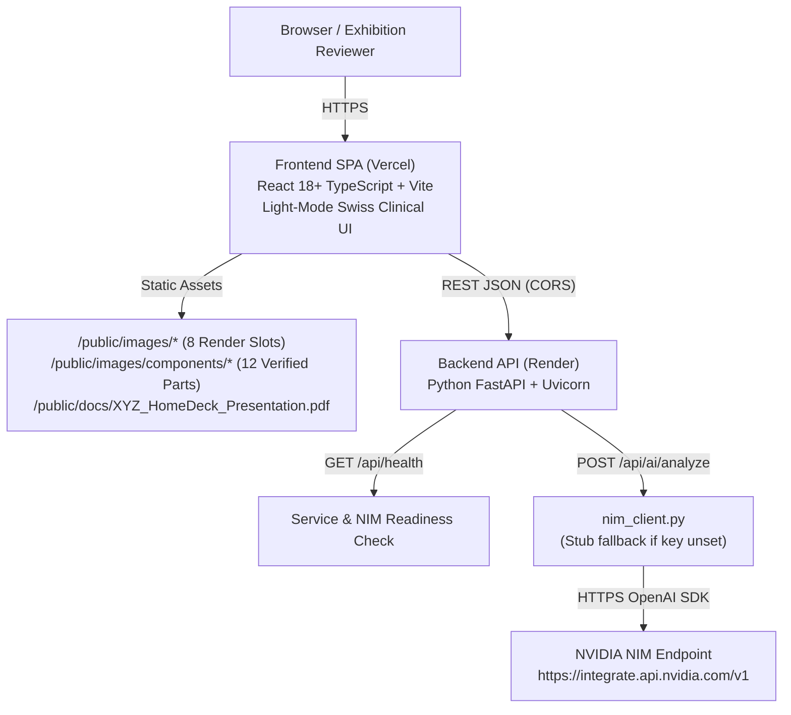

# XYZ Home Deck — System Architecture & 5-Phase Plan

> **Stationary Autonomous Elderly Care, Vitals & Emergency Guardian**  
> Paschim Banga Bigyan Mancha Science Exhibition & Department Funding Proposal  
> Team: Aryan Banerjee · Sourav Biswas · Roktim · Arjya

---

## 1. Flagship Dual-Brain Hardware Architecture

XYZ Home Deck eliminates single points of failure by decoupling human-facing presentation and computer vision from real-time safety sensing and actuator reflex control.



### Why Two Brains?
1. **Interface Brain (`Raspberry Pi 4 Model B 4GB`)**: Drives the 7-inch 60 FPS capacitive touchscreen (`Standby`, `Daily Vitals`, `Emergency 10s Countdown`), OV5647 fisheye camera capture, multilingual audio prompts (Bengali, Hindi, English), and Gigabit Ethernet 1080p @ 30 FPS streaming to local GPU laptops.
2. **Reflex Brain (`ESP32-S3-DevKitC-1 N16R8`)**: Samples all biometric, radar, gas, acoustic, tilt, and battery sensors continuously over I2C/UART/ADC/GPIO, executes local fan-relay hazard responses, controls the 2-axis pan-tilt camera gimbal, and stays active even if the display layer restarts.

---

## 2. Power Continuity & Outage Architecture (Indian Grid Resilience)



- Zero reboot brownout during monsoon or summer power cuts.
- Live charge state and current draw reported directly to the kiosk HUD via `INA219`.

---

## 3. Virtual Tour & Sandbox Full-Stack Web Architecture

This repository powers the interactive Virtual Tour & Hardware Sandbox (`xyz-home-deck-sandbox`), split cleanly for **Vercel** and **Render** hosting:



### Repository Structure
```text
/
├── ARCHITECTURE.md
├── README.md
├── frontend/                  # Vercel deploy root
│   ├── vercel.json            # SPA catch-all rewrite -> /index.html
│   ├── .env.example           # VITE_API_BASE_URL=http://localhost:8000
│   ├── public/
│   │   ├── docs/              # XYZ_HomeDeck_Presentation.pdf
│   │   └── images/            # 8 user drop-in render/photo slots + components/
│   └── src/
│       ├── styles/tokens.css  # Light-mode clinical & industrial design tokens
│       ├── data/hardwareBom.ts# Complete 27-row PDF-verified BOM + 12 photo cards
│       ├── components/        # Navbar, SafeImage, BackendStatus, ComponentCard, Lightbox
│       └── pages/             # OverviewTour, KioskSandbox, ElderSetup, HardwareLab
└── backend/                   # Render deploy root
    ├── render.yaml            # Web Service blueprint
    ├── requirements.txt       # FastAPI, Uvicorn, Pydantic, OpenAI, python-dotenv, httpx
    ├── .env.example           # NVIDIA_API_KEY, NVIDIA_NIM_MODEL, FRONTEND_ORIGIN
    └── app/
        ├── main.py            # FastAPI bootstrap & CORS
        ├── config.py          # Environment loader & NIM readiness checks
        ├── services/nim_client.py
        └── routers/
            ├── health.py      # GET /api/health
            └── ai_sandbox.py  # POST /api/ai/analyze
```

### API Contract (Phase 1 Base)
| Endpoint | Method | Purpose | Behavior Without `NVIDIA_API_KEY` |
| --- | --- | --- | --- |
| `/api/health` | `GET` | Service status, phase metadata, and NIM configuration state | Returns `200 OK` with `nim_configured: false`, `mode: "stub"` |
| `/api/ai/analyze` | `POST` | Structured telemetry/sandbox AI evaluation endpoint | Returns deterministic Phase 1 placeholder response (`mode: "stub"`) without crashing |

---

## 4. Deployment Notes (Vercel + Render)

### Frontend on Vercel
- **Root Directory**: `frontend`
- **Build Command**: `npm run build`
- **Output Directory**: `dist`
- **SPA Routing**: Handled by `frontend/vercel.json` (`/(.*) -> /index.html`).
- **Environment Variable**: `VITE_API_BASE_URL` pointing to your Render HTTPS URL (e.g. `https://xyz-home-deck-api.onrender.com`).

### Backend on Render
- **Root Directory**: `backend`
- **Build Command**: `pip install -r requirements.txt`
- **Start Command**: `uvicorn app.main:app --host 0.0.0.0 --port $PORT`
- **Health Check Path**: `/api/health`
- **Environment Variables**:
  - `NVIDIA_API_KEY`: Secret key from NVIDIA Build / NIM (`nvapi-...`).
  - `NVIDIA_NIM_MODEL`: Default `meta/llama-3.1-8b-instruct`.
  - `NVIDIA_NIM_BASE_URL`: `https://integrate.api.nvidia.com/v1`.
  - `FRONTEND_ORIGIN`: Comma-separated allowed origins (e.g. `https://xyz-home-deck.vercel.app,http://localhost:5173`).

---

## 5. Five-Phase Build Roadmap

1. **Phase 1 (Current — Base Architecture & Design System):** Monorepo scaffolding, Swiss clinical Light-Mode tokens, SPA navigation shell, 8 product render asset slots (`SafeImage`), verified 12-component interactive gallery (zero hover-zoom, hover data popover, click-to-expand fullscreen modal) backed by PDF-verified BOM (`SKUs` + `₹` pricing), FastAPI health + NVIDIA NIM placeholder service, and GitHub push.
2. **Phase 2 (60 FPS Kiosk Sandbox & Escalation Simulator):** Interactive 7-inch touchscreen simulator switching across Standby, Daily Vitals (MAX30102 waveform + SpO₂ + MLX90614 IR temp), and 10-second Emergency Countdown HUDs, paired with manual sensor sliders, gas-relay simulation, and multilingual voice prompt playback (Bengali / Hindi / English).
3. **Phase 3 (Age-Adaptive Elder Setup & Calibration):** Guided onboarding workflow for registering parents, learning personalized vitals baselines (vs generic textbook thresholds), adaptive button/text pacing for frailty/age, and guest privacy screen behavior.
4. **Phase 4 (Hardware Lab & Interactive Hotspots):** Coordinate-mapped interactive sensor hotspots overlaid on `frontside.jpg` and `ups.jpg`, full 27-part BOM filtering/cost breakdown (`≈ ₹14,600`), and PLA+ 3D enclosure inspection.
5. **Phase 5 (Live NVIDIA NIM Sandbox & Production Hardening):** Real-time clinical anomaly narrative and triage reasoning powered by NVIDIA NIM (`POST /api/ai/analyze`), performance verification, and live exhibition showcase polish.
